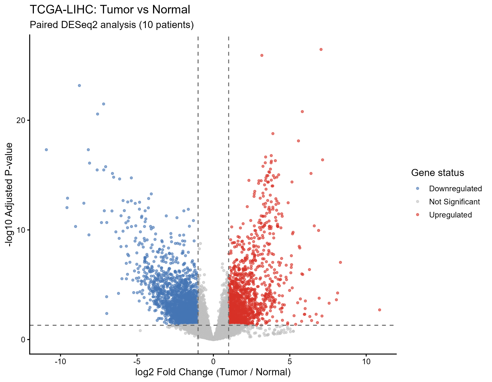
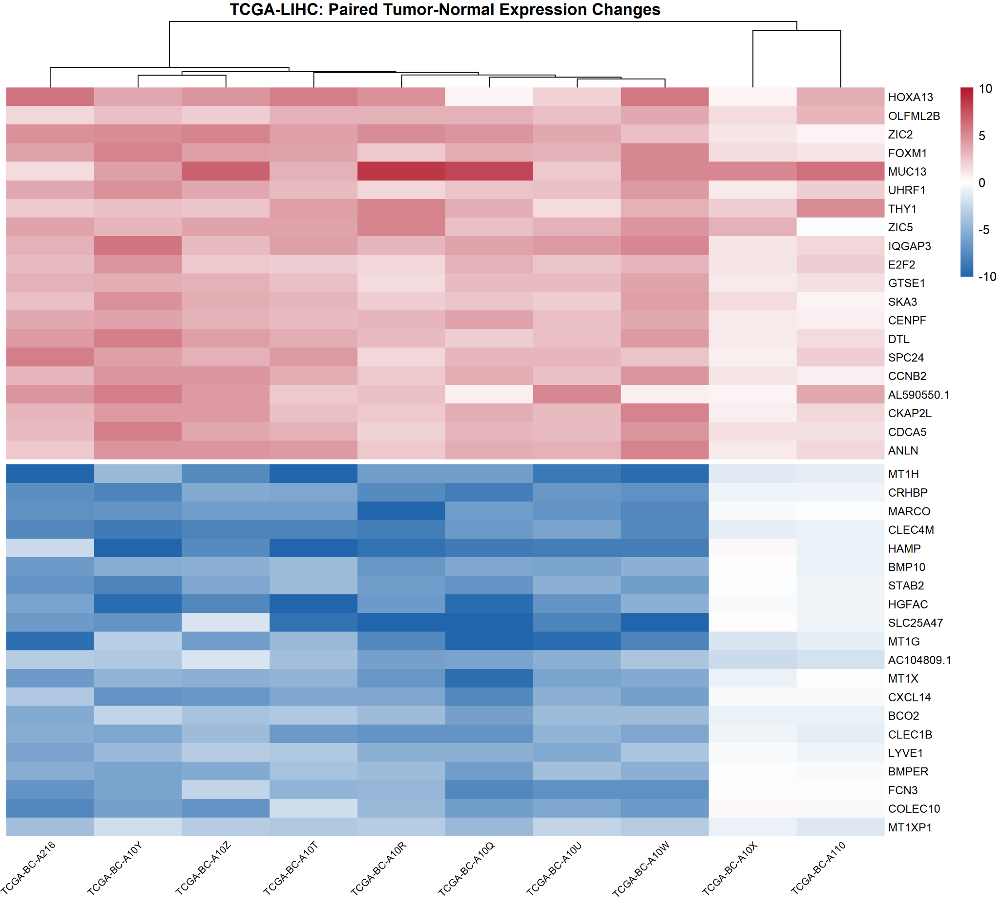
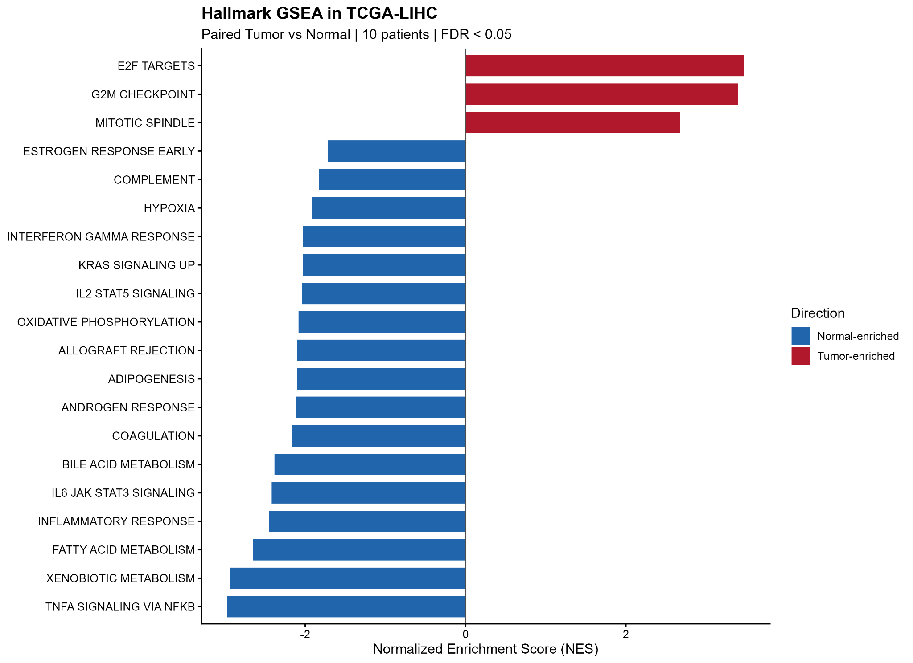
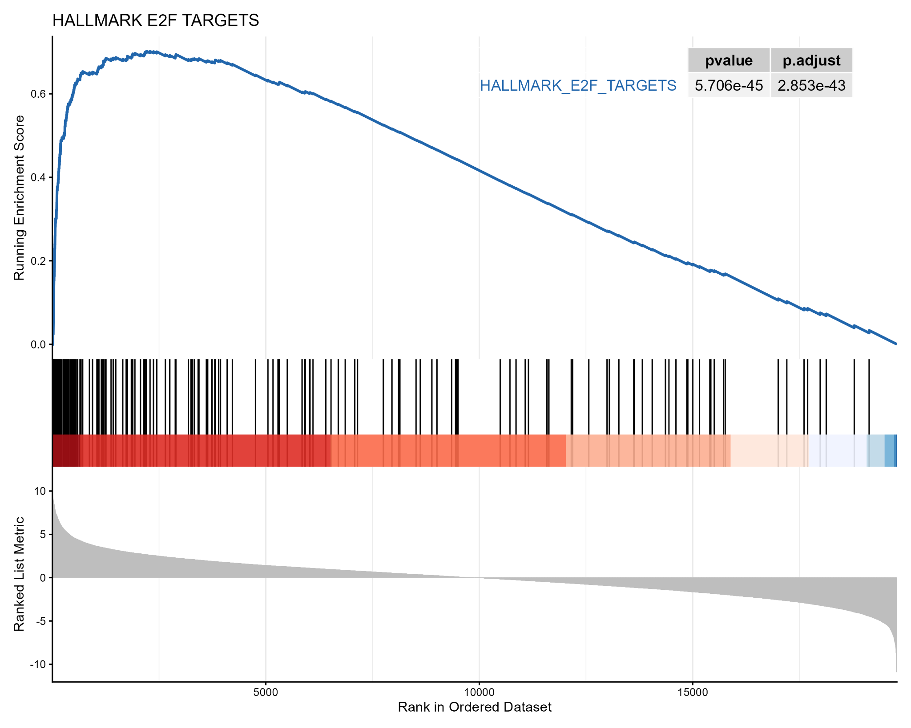

# Paired bulk RNA-seq and Hallmark GSEA in hepatocellular carcinoma (TCGA-LIHC)

**Author:** Belal Abdellah  
**Scope:** Exploratory, reproducible analysis of 10 matched tumor–normal pairs from TCGA-LIHC (not a full-cohort study).

## Overview

This repository demonstrates paired differential expression analysis of liver hepatocellular carcinoma (LIHC) and pathway-level interpretation using the MSigDB Hallmark collection. The 10 paired patients were selected **deterministically as the first 10 eligible IDs in sorted order**, *not randomly*, from a pool of 50 eligible matched patients identified in the GDC query. Results should not be generalized to all TCGA-LIHC tumors.

## Data and design

| Item | Specification |
| --- | --- |
| Source | [NCI Genomic Data Commons](https://portal.gdc.cancer.gov/), TCGA-LIHC |
| Genome / workflow | hg38; GDC RNA-seq `STAR - Counts` |
| Samples analyzed | 10 patients with one primary tumor and one solid tissue normal RNA-seq sample each (20 samples) |
| Raw counts | `unstranded` assay extracted from `SummarizedExperiment` |
| Gene features in prepared data | 60,660 |
| Design | DESeq2 `~ patient_id + condition` (Normal as reference) |
| Contrast | Tumor vs Normal |
| Prefilter | Gene count ≥ 10 in at least 5 samples |
| Differential expression reporting cutoff | BH-adjusted *p* < 0.05 and absolute log2 fold change > 1 |
| Hallmark GSEA | Preranked by DESeq2 Wald statistic (all tested genes with finite statistic); human MSigDB H collection, `fgsea` through `clusterProfiler`; BH FDR < 0.05 |
| Paired heatmap | 20 tumor-up and 20 tumor-down genes; VST(Tumor) − VST(Normal) within each individual; exploratory Pearson-correlation / average-linkage patient clustering |

**Important:** Gene set analysis and heatmap selection reuse the same cohort and are not independent validation. Bulk RNA-seq reflects cell-type composition as well as within-cell transcriptional changes.

## Verified differential expression results

| Statistic | Count |
| --- | ---: |
| Genes remaining after prefilter / reported in results | 19,782 |
| Significant by both thresholds | 3,782 |
| Higher in tumors | 1,574 |
| Lower in tumors | 2,208 |

Counts were recalculated directly from [`results/HCC_DESeq2_Tumor_vs_Normal.csv`](results/HCC_DESeq2_Tumor_vs_Normal.csv). The CSV contains 7 columns: `baseMean`, `log2FoldChange`, `lfcSE`, `stat`, `pvalue`, `padj`, `gene_id`.

## Figures

**Differential expression overview**

**Patient-matched expression changes (VST difference, tumor minus normal)**

**Hallmark enrichment overview**

**Representative GSEA enrichment curve: E2F targets**

The E2F enrichment figure reports nominal p ≈ 5.706 × 10⁻⁴⁵ and adjusted p ≈ 2.853 × 10⁻⁴³ (read from the provided figure). **The full pathway CSV and database-version log have not yet been provided for independent numerical verification.** Those should be exported from the local GSEA object before treating this archive as a complete analysis deposit.

## Biological interpretation

See [`biological_interpretation.md`](biological_interpretation.md) for a separate, appropriately qualified interpretation of cellular proliferation, metabolism, inflammatory programs, and interpatient heterogeneity.

## Reproduction and local execution

RStudio with R 4.4.2 / Bioconductor 3.20 was used during the original workflow. Tools included `TCGAbiolinks` 2.34.1, `DESeq2`, `SummarizedExperiment`, `ggplot2`, `pheatmap`, `clusterProfiler`, `enrichplot`, and `msigdbr`. Check the locally saved `session_info.txt` / `GSEA_session_info.txt` for precise versions if available.

1. Create/open an RStudio project in the repository root, and install packages compatible with your R/Bioconductor environment.
2. Run [`scripts/01_download_and_prepare.R`](scripts/01_download_and_prepare.R) to fetch the exact reproducible subset of patient-matched STAR count files. **This downloads external data (~84 MB for the selected 20 files at the time of the original analysis).** GDC availability and metadata can change.
3. Run [`scripts/02_deseq2_and_volcano.R`](scripts/02_deseq2_and_volcano.R) to save DESeq2 results and a volcano plot.
4. Run [`scripts/03_paired_delta_heatmap.R`](scripts/03_paired_delta_heatmap.R) to generate the 40-gene paired expression-change heatmap, using the source gene annotations.
5. Run [`scripts/04_hallmark_gsea.R`](scripts/04_hallmark_gsea.R) to regenerate complete Hallmark results and plots from the fitted DESeq2 model. **Do not assume byte-identical results across database/package versions.**

The scripts have been assembled from the documented workflow for portability but **have not been executed end-to-end in this environment** (raw count files and the GSEA model were not uploaded here). The figures in this repository were supplied from the actual user's RStudio run; the CSV was independently checked against the stated counts.

## Repository contents

- `results/HCC_DESeq2_Tumor_vs_Normal.csv` — actual exported gene-level results.
- `figures/` — four exported figures from the local analysis.
- `scripts/` — clean scripts for rerunning data retrieval, statistical analysis, and visualization.
- `biological_interpretation.md` — interpretation, caveats, and follow-up questions.
- `.gitignore` — prevents accidentally committing large count downloads / model files.

**To add before final archiving:** `Hallmark_GSEA_All_Results.csv`, `Hallmark_GSEA_Significant.csv`, and locally generated session / MSigDB version information; see code at the end of `scripts/04_hallmark_gsea.R`.

## Limitations

Small, nonrandom exploratory subset (n = 10 pairs); no explicit independent validation, no full-cohort sensitivity analysis, and no formal assessment of clinical confounders or cellular composition. Clustering is descriptive and based on DE-selected genes. Enrichment direction does not prove functional pathway activation or causation. Some pathway interpretations are not identifiable from bulk tissue alone.

## Sources and citation

- [NCI GDC Portal](https://portal.gdc.cancer.gov/)
- [TCGAbiolinks documentation](https://bioconductor.org/packages/TCGAbiolinks/)
- [DESeq2](https://bioconductor.org/packages/DESeq2/)
- [MSigDB Hallmark gene sets](https://www.gsea-msigdb.org/gsea/msigdb/human/collections.jsp)
- Subramanian A et al. (2005). Gene set enrichment analysis. *PNAS*. [DOI](https://doi.org/10.1073/pnas.0506580102)
- Love MI et al. (2014). Moderated estimation of fold change and dispersion for RNA-seq data with DESeq2. *Genome Biology*. [DOI](https://doi.org/10.1186/s13059-014-0550-8)
- Liberzon A et al. (2015). The Molecular Signatures Database (MSigDB) hallmark gene set collection. *Cell Systems*. [DOI](https://doi.org/10.1016/j.cels.2015.12.004)

This repository is a personal research portfolio demonstration, not an independently peer-reviewed publication.
